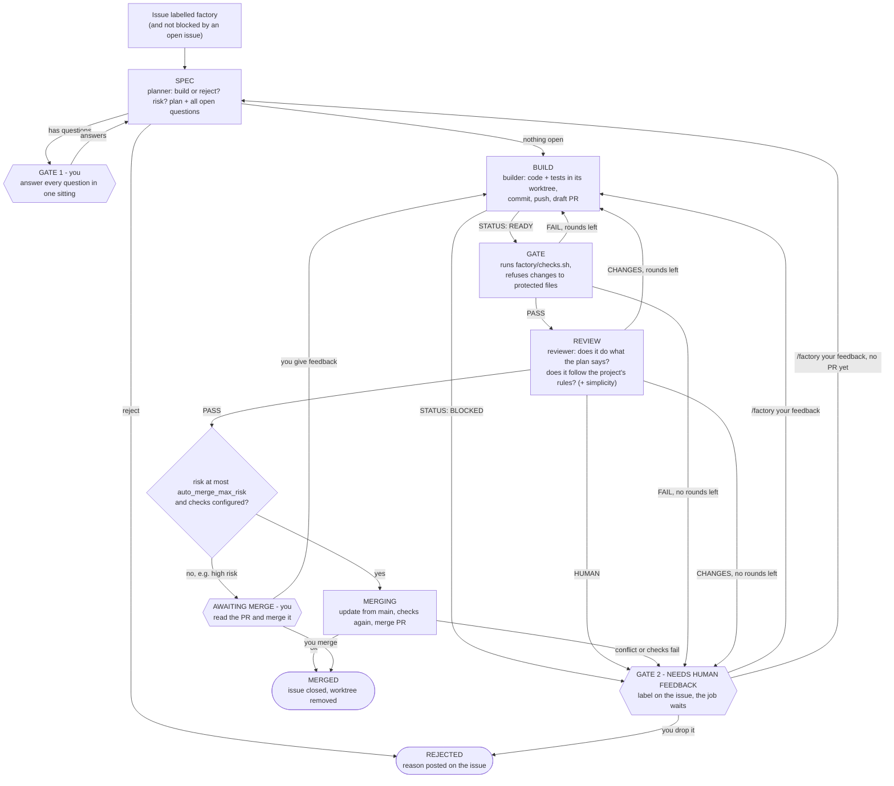
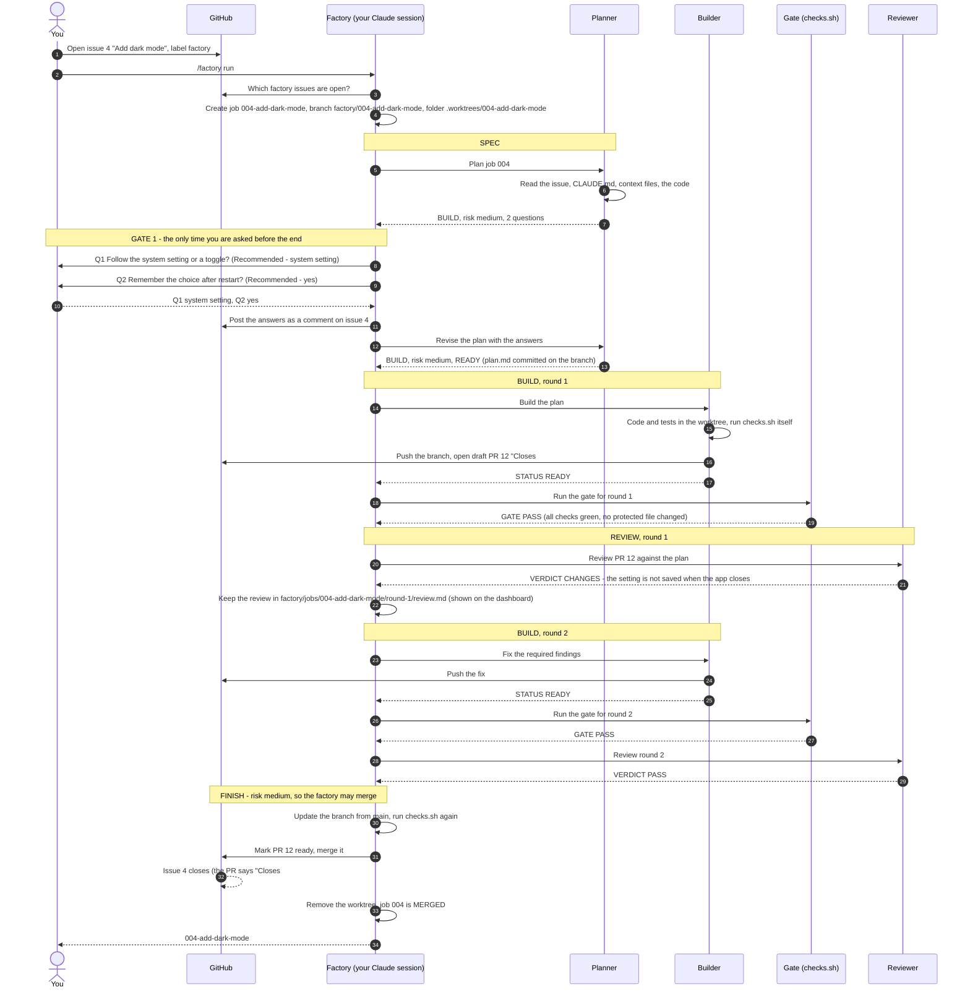

# How the factory works

Two diagrams: first the factory as a whole, then one feature followed from the issue to the merged pull request.

## Words used below

- **Issue**: a task on GitHub ("Add dark mode"). The factory only takes issues that carry the label `factory`.
- **Label**: a coloured tag on an issue. Only people with triage or write access to the repository can add one, so the label decides who can give the factory work.
- **Branch / worktree**: each job gets its own git branch, `factory/<job>`, checked out in its own folder `.worktrees/<job>/`. Your own checkout is never touched while the factory works.
- **Pull request (PR)**: the proposed change, shown on GitHub. The builder opens it as a **draft** (not ready to merge yet). Its description says `Closes #<issue>`, so merging it closes the issue.
- **Merge**: putting the PR's changes into the main branch (`base_branch` in `factory/config.json`, usually `main`).
- **Risk**: the planner rates every job `low`, `medium` or `high`. `factory/risk.md` says what is high risk in your project. High-risk PRs are never merged by the factory.
- **Checks**: `factory/checks.sh`, the project's own tests, lint, build. The **gate** runs them.
- **Round**: one pass of build → gate → review. A job gets at most `max_rounds` (default 3) before it stops and asks you.
- **Agent**: a Claude subagent with one job: the **planner**, the **builder** or the **reviewer**. The **orchestrator** is your own Claude Code session after you type `/factory run`; it starts the agents and runs the scripts, but writes no code itself.

## 1. The whole factory

What to read from it:

- **You are needed in three places only**, the hexagons: answering questions before any code is written (gate 1), merging high-risk PRs, and unblocking a stuck job (gate 2). Everything else runs without asking you.
- **Between gate 1 and the end nothing interrupts you.** A job that can't continue does not ask a question; it stops, gets the label `factory:needs-human-feedback`, and waits until you answer with `/factory <your words>`. The other jobs keep going.
- **Up to `concurrency` jobs run at once** (default 3), each in its own worktree.
- **Every state change goes through `factory/bin/job`.** It checks the files that justify a move (no PR → no gate, no `GATE: PASS` → no review) and refuses the move otherwise.

## 2. An example: "Add dark mode"

You open issue #4 *"Add dark mode"* with the label `factory`, then type `/factory run` in Claude Code in that project.

What happened, step by step:

1. **You** wrote what you want as an issue and added the label `factory`. You can write it in any language; the planner asks its questions in the issue's language.
2. **The factory** found the issue and created job `004-add-dark-mode`: a branch and a separate folder, so your own checkout stays as it was.
3. **The planner** read the issue, the project's `CLAUDE.md`, the files in `context_files` and the code. It decided to build it, rated it `medium` (several files, nothing hard to undo) and found two things only you can decide.
4. **Gate 1.** You got both questions at once, each with a recommended answer you can accept in one click. Your answers were posted on the issue, so the decision is recorded on GitHub too.
5. **The planner** rewrote the plan (`context/004-add-dark-mode/plan.md` on the branch): phases, the files each phase changes, and acceptance criteria that can be checked as true or false.
6. **The builder** wrote the code and tests in the job's folder, ran the checks itself, pushed the branch and opened a draft PR.
7. **The gate** ran `factory/checks.sh` from your main checkout, not from the branch, so the builder can't change the checks it is judged by. It also failed the round if a protected file (the factory itself, the checks, settings) had changed.
8. **The reviewer** compared the PR with the plan and your answers and found a real gap: the choice was not saved. That is a **required** finding, so the job went back to the builder for round 2. You weren't asked. The review stays in the job's folder (`factory/jobs/004-add-dark-mode/round-1/review.md`, also on the dashboard); it is not posted on GitHub.
9. **Round 2** fixed it; checks and review passed.
10. **Finish.** The risk was `medium` and `auto_merge_max_risk` is `medium`, so the factory merged the PR itself, after updating it from `main` and running the checks once more. Merging closed the issue.

How the same issue could have ended differently:

- **Rated `high`** (say it changed a stored data format): after step 9 the factory marks the PR ready, adds the label `factory:awaiting-merge`, and posts on the PR what is risky and what to check by hand. **You** merge it.
- **Checks or review fail 3 rounds in a row**, the builder is **blocked** (the plan can't work as written), or the reviewer answers **HUMAN** (only you can settle it): the job stops with the label `factory:needs-human-feedback` and a comment explaining why. You answer with `/factory 004: <your words>`, and it starts a new round with a fresh round budget.
- **The planner rejects it** (it doesn't belong in this project, or it already exists): the reason is posted on the issue, the label `factory` is removed, and no code is written.
- **The checks are not configured yet** (`checks_configured: false`): the factory never merges by itself, whatever the risk; every PR waits for you.

Watch it live with `/factory dashboard`, or ask `/factory status`.
